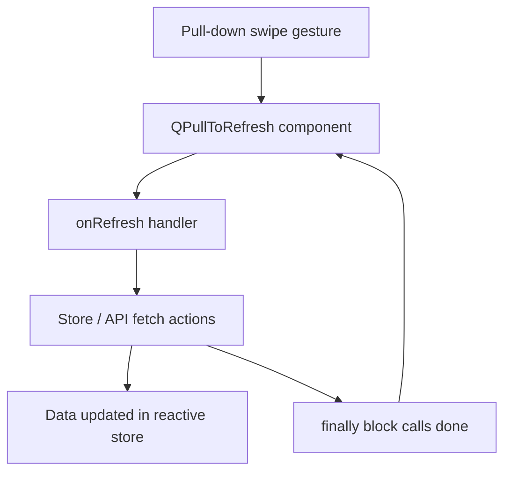

# Pull-to-Refresh
Pull-down gesture to refresh view data with visible indicator across all content screens.

## Goal
Allow users to reload active page data by dragging down from the top of the view on mobile and touch devices.

## Key Files
| File | Role |
|------|------|
| `packages/web/src/pages/IndexPage.vue` | Home dashboard pull-to-refresh wrapping rehearsal, gig, and member data |
| `packages/web/src/pages/CalendarPage.vue` | Calendar pull-to-refresh wrapping events, attendance, and member data |
| `packages/web/src/pages/VotingPage.vue` | Voting pull-to-refresh wrapping song suggestions and member votes |
| `packages/web/src/pages/SetlistPage.vue` | Setlist pull-to-refresh wrapping master, user, and gig setlists |

## Data Flow

## Error Handling
| Scenario | Behavior |
|----------|----------|
| Network error during refresh | `done()` is always invoked in a `finally` block to dismiss the refresh indicator safely |
