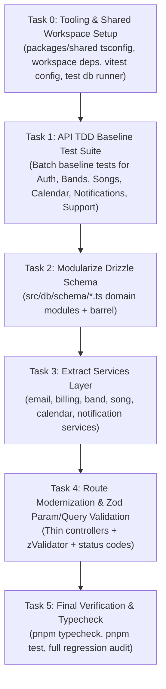

# Implementation Plan: Refactor Application to APM Guidelines (Phase 1: API & Shared)

> **For agentic workers:** REQUIRED SUB-SKILL: Use `superpowers:executing-plans` or `superpowers:subagent-driven-development` to execute this plan task-by-task. Follow the APM Refactoring Protocol: never refactor and add tests in the same commit. Every task ends with a checkable result and commit.

**Goal:** Refactor the API backend (`packages/api`) and shared package (`packages/shared`) to strictly comply with APM architecture, testing, and style guidelines, using TDD with Vitest against a live PostgreSQL test database to guarantee 100% feature parity. *(Web SFC modernizations scheduled for Phase 2).*

**Architecture:** 
- **Layer Structure** (`packages/api`): 4 distinct tiers:
  1. `src/routes/`: Thin HTTP controllers using Hono instance. Validate all params, queries, and bodies via `@hono/zod-validator` (`zValidator`).
  2. `src/services/`: Domain-scoped service modules (`band.service.ts`, `song.service.ts`, `calendar.service.ts`, `billing.service.ts`, `email.service.ts`, `notification.service.ts`) exporting pure async functions handling business logic and external APIs.
  3. `src/db/schema/`: Modular table and relations schemas (`bands.ts`, `auth.ts`, `songs.ts`, `calendar.ts`, `notifications.ts`, `index.ts`), with `src/db/schema.ts` preserved as a backwards-compatible barrel.
  4. `src/middleware/`: Auth (`requireAuth`), multi-tenancy (`requireTenant`), RBAC (`requireRole`), and logging.
- **Shared** (`packages/shared`): Strict composite TypeScript configuration with workspace dependency syntax (`"workspace:*"`).
- **Testing**: Vitest suite with end-to-end middleware authentication, testing HTTP handlers via `app.request()`, running against a live PostgreSQL test container with transaction rollbacks/cleanups and mocked Stripe/Nodemailer transports (`vi.spyOn`).

**Tech Stack:** Hono, Drizzle ORM, PostgreSQL, Better Auth, Zod, Stripe SDK, Nodemailer, Vitest, TypeScript 5.8 (Strict), pnpm v10 workspaces.

---

## Global Constraints

- **Refactoring Protocol**: Never combine adding tests and refactoring in the same commit. Tests must pass before and after refactoring to prove behavior is preserved.
- **Commit Granularity**: Batch baseline test suite committed first (`test(api): add baseline tests...`), followed by per-domain refactoring commits (`refactor(api): ...`).
- **Database & Test Isolation**: Integration tests run against PostgreSQL test database using transaction rollbacks or truncated test tables between test suites.
- **Zod Validation**: Every route param (`zValidator('param', ...)`), query parameter (`zValidator('query', ...)`), and JSON body (`zValidator('json', ...)`).
- **HTTP Status Codes**: `200 OK`, `201 Created`, `400 Bad Request`, `401 Unauthorized`, `403 Forbidden`, `404 Not Found`, `500 Internal Error`.
- **Drizzle**: Schema modularized under `src/db/schema/*.ts`; `src/db/schema.ts` maintained for full backward compatibility.

---

## Decision Log (from /grill-me)

1. **Scope & Phasing**: Two-phase delivery — Phase 1 focuses completely on API & Shared; Phase 2 handles Web SFC and Quasar style modernization.
2. **Database Testing Strategy**: Live PostgreSQL test container/instance (matches `docker-compose.dev.yml` and APM guidelines, with transaction isolation).
3. **Auth Testing Strategy**: End-to-end middleware testing — seed test user & session in the test DB and dispatch requests with valid session tokens/headers.
4. **Service Architecture**: Domain-scoped service modules (`band.service.ts`, `song.service.ts`, etc.) exporting pure async functions adhering to the APM Layer Structure.
5. **Commit Granularity**: Batch baseline commit first across all domains, then commit refactors per domain.

---

## Proposed Tasks & Changes



---

### Task 0: Tooling & Shared Workspace Setup

**Files:**
- Create: `packages/shared/tsconfig.json`
- Modify: `packages/api/package.json`
- Modify: `packages/web/package.json`
- Modify: `package.json`
- Create: `packages/api/vitest.config.ts`

- [ ] **Step 1: Create `packages/shared/tsconfig.json`**
  Add composite strict configuration for `@bandstr/shared`.

- [ ] **Step 2: Update dependencies in `package.json` and `packages/api/package.json`**
  - Add `"@bandstr/shared": "workspace:*"` to `packages/api/package.json` and `packages/web/package.json`.
  - Add `vitest` and `@types/node` to `packages/api/devDependencies`.
  - Add `"test": "vitest run"` and `"test:watch": "vitest"` to `packages/api/package.json`.
  - Add `"test": "pnpm --filter @bandstr/api run test"` to root `package.json`.

- [ ] **Step 3: Create `packages/api/vitest.config.ts`**
  Configure Vitest with `environment: 'node'`, `setupFiles: ['./tests/setup.ts']`.

- [ ] **Step 4: Verify typecheck passes**
  Run: `pnpm typecheck`
  Expected: PASS

- [ ] **Step 5: Commit tooling setup**
  ```bash
  git add packages/shared/tsconfig.json packages/api/package.json packages/web/package.json package.json packages/api/vitest.config.ts
  git commit -m "build(api): configure shared tsconfig, vitest, and workspace dependencies"
  ```

---

### Task 1: API TDD Baseline Test Suite (Batch Baseline)

Following the APM Refactoring Protocol: *Audit and add tests against existing code, run and pass them, commit tests separately before refactoring.*

**Files:**
- Create: `packages/api/tests/setup.ts`
- Create: `packages/api/tests/helpers/test-db.ts`
- Create: `packages/api/tests/helpers/test-auth.ts`
- Create: `packages/api/tests/routes/health.test.ts`
- Create: `packages/api/tests/routes/bands.test.ts`
- Create: `packages/api/tests/routes/songs.test.ts`
- Create: `packages/api/tests/routes/calendar.test.ts`
- Create: `packages/api/tests/routes/notifications.test.ts`
- Create: `packages/api/tests/routes/support.test.ts`

- [ ] **Step 1: Create test setup & helpers**
  - `test-db.ts`: helper to connect to test Postgres, run migrations, and clean/truncate test tables before/after test suites.
  - `test-auth.ts`: helper to create a test user, band, and session token, providing headers:
    `{ Authorization: 'Bearer <token>', 'X-Band-Id': '<id>' }`.
  - `setup.ts`: global mocks for Stripe and Nodemailer (`vi.spyOn`).

- [ ] **Step 2: Write baseline route tests**
  - `/health`: verifies `{ ok: true, version: ... }`.
  - `/api/bands`: verifies listing bands, creating band, role validation, free plan limit (1 band max).
  - `/api/songs`: verifies listing songs, filtering by setlist, creating song, updating song, Spotify resolution.
  - `/api/calendar`: verifies listing events, event creation, rehearsal proposals, RSVP attendance.
  - `/api/notifications`: verifies unread count, listing notifications, mark-as-read.
  - `/api/support`: verifies support ticket submission and Nodemailer invocation.

- [ ] **Step 3: Run baseline tests to verify 100% pass on CURRENT unrefactored code**
  Run: `pnpm test`
  Expected: All tests PASS.

- [ ] **Step 4: Commit batch baseline tests**
  ```bash
  git add packages/api/tests
  git commit -m "test(api): add comprehensive baseline test suite locking in existing route behavior"
  ```

---

### Task 2: Database Schema Modularization

Following APM guideline: *Define table schemas in `src/db/schema/` using Drizzle column builders. Export relations using `relations()` builder.*

**Files:**
- Create: `packages/api/src/db/schema/bands.ts`
- Create: `packages/api/src/db/schema/auth.ts`
- Create: `packages/api/src/db/schema/songs.ts`
- Create: `packages/api/src/db/schema/calendar.ts`
- Create: `packages/api/src/db/schema/notifications.ts`
- Create: `packages/api/src/db/schema/index.ts`
- Modify: `packages/api/src/db/schema.ts` (re-export barrel)
- Modify: `packages/api/drizzle.config.ts`

- [ ] **Step 1: Extract domain schemas into `src/db/schema/`**
  - `bands.ts`: `bands`, `bandMembers`, `bandInviteCodes`, `bandsRelations`.
  - `auth.ts`: `users`, `sessions`, `accounts`, `verifications`, `organizations`, `members`, `invitations`, `usersRelations`.
  - `songs.ts`: `songs`, `votes`, `userSetlistSongs`, `songsRelations`.
  - `calendar.ts`: `calendarEvents`, `personalNotes`, `rehearsalAttendance`, `rehearsalTimeProposals`, `rehearsalSongs`, `gigSetlists`, `gigSongs`.
  - `notifications.ts`: `userNotificationSettings`, `pendingNotifications`, `userNotifications`, `userPushDevices`.

- [ ] **Step 2: Create `src/db/schema/index.ts` and barrel in `src/db/schema.ts`**
  Re-export all tables and relations to ensure zero breaking changes across the codebase.

- [ ] **Step 3: Update `drizzle.config.ts`**
  Point schema to `./src/db/schema/index.ts`.

- [ ] **Step 4: Run tests & typecheck to verify 100% feature parity**
  Run: `pnpm typecheck && pnpm test`
  Expected: PASS

- [ ] **Step 5: Commit modularized schema**
  ```bash
  git add packages/api/src/db/schema packages/api/src/db/schema.ts packages/api/drizzle.config.ts
  git commit -m "refactor(api): modularize drizzle schema into src/db/schema domain modules"
  ```

---

### Task 3: Service Layer Extraction

Following APM guideline: *Services (`src/services/`): Implement business logic, Stripe payment flows, and email sending.*

**Files:**
- Create: `packages/api/src/services/email.service.ts`
- Create: `packages/api/src/services/billing.service.ts`
- Create: `packages/api/src/services/band.service.ts`
- Create: `packages/api/src/services/song.service.ts`
- Create: `packages/api/src/services/calendar.service.ts`
- Create: `packages/api/src/services/notification.service.ts`

- [x] **Step 1: Implement `email.service.ts` and `billing.service.ts`**
  Pure async functions for Nodemailer dispatch and Stripe customer/checkout/webhook operations.

- [x] **Step 2: Implement `band.service.ts` and `song.service.ts`**
  Domain operations: band membership, slug retry loop, plan normalization, song CRUD, setlist ordering.

- [x] **Step 3: Implement `calendar.service.ts` and `notification.service.ts`**
  Calendar events, RSVP attendance, proposals, notifications query, push devices.

- [x] **Step 4: Run tests & typecheck**
  Run: `pnpm typecheck && pnpm test`
  Expected: PASS

- [x] **Step 5: Commit services layer**
  ```bash
  git add packages/api/src/services
  git commit -m "feat(api): extract business logic and external integrations into services layer"
  ```

---

### Task 4: Route Modernization & Zod Param/Query Validation

Following APM guideline: *Always validate request parameters, query, and body using `@hono/zod-validator` middleware (`zValidator`). Return typed JSON responses using `c.json()`. Use HTTP status codes consistently (`200 OK`, `201 Created`, `400 Bad Request`, `401 Unauthorized`, `404 Not Found`, `500 Internal Error`).*

**Files:**
- Modify: `packages/api/src/routes/bands.ts`
- Modify: `packages/api/src/routes/songs.ts`
- Modify: `packages/api/src/routes/calendar.ts`
- Modify: `packages/api/src/routes/gigs.ts`
- Modify: `packages/api/src/routes/rehearsals.ts`
- Modify: `packages/api/src/routes/notifications.ts`
- Modify: `packages/api/src/routes/billing.ts`
- Modify: `packages/api/src/routes/support.ts`
- Modify: `packages/api/src/routes/users.ts`

- [x] **Step 1: Refactor `routes/bands.ts` and `routes/songs.ts`**
  - Add `zValidator('param', idParamSchema)`.
  - Delegate logic to `bandService` and `songService`.
  - Standardize status codes (`201` for creations, `200` for updates/reads, `404` for missing records).
  - Verify tests: `pnpm test`
  - Commit:
    ```bash
    git add packages/api/src/routes/bands.ts packages/api/src/routes/songs.ts
    git commit -m "refactor(api): modernize bands and songs routes with zValidator and service delegation"
    ```

- [x] **Step 2: Refactor `routes/calendar.ts`, `routes/gigs.ts`, `routes/rehearsals.ts`**
  - Add `zValidator` for path params and query parameters.
  - Delegate to `calendarService`.
  - Verify tests: `pnpm test`
  - Commit:
    ```bash
    git add packages/api/src/routes/calendar.ts packages/api/src/routes/gigs.ts packages/api/src/routes/rehearsals.ts
    git commit -m "refactor(api): modernize calendar, gigs, and rehearsals routes with zValidator and services"
    ```

- [x] **Step 3: Refactor `routes/notifications.ts`, `routes/billing.ts`, `routes/support.ts`, `routes/users.ts`**
  - Add `zValidator` for path params and queries (`sinceId`, `limit`, etc.).
  - Delegate to `notificationService`, `billingService`, `emailService`.
  - Verify tests: `pnpm test`
  - Commit:
    ```bash
    git add packages/api/src/routes/notifications.ts packages/api/src/routes/billing.ts packages/api/src/routes/support.ts packages/api/src/routes/users.ts
    git commit -m "refactor(api): modernize notifications, billing, support, and users routes with zValidator"
    ```

---

### Task 5: Final Verification & Monorepo Audit

- [x] **Step 1: Run workspace typecheck**
  Run: `pnpm typecheck`
  Expected: PASS with 0 errors across all packages.

- [x] **Step 2: Run full Vitest test suite**
  Run: `pnpm test`
  Expected: 100% tests passing.

- [x] **Step 3: Run backend build**
  Run: `pnpm build:api`
  Expected: Successful compilation to `dist/`.

---

## Verification Plan

### Automated Tests
- `pnpm typecheck`: Strict TypeScript check across the entire workspace.
- `pnpm test`: Full API Vitest suite verifying route status codes, response schemas, validation rules, auth, and service logic.
- `pnpm build:api`: Production build verification for the API package.

### Manual Verification
- Start API server (`pnpm dev:api`).
- Run `curl -s http://localhost:3001/health` and verify `{ "ok": true, "version": ... }`.
