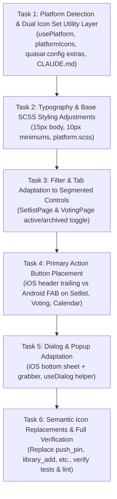

# Implementation Plan: Adapt to iOS and Android Design Guidelines (#36)

> **For agentic workers:** REQUIRED SUB-SKILL: Use superpowers:subagent-driven-development or superpowers:executing-plans to implement this plan task-by-task. Steps use checkbox (`- [ ]`) syntax for tracking.

**Goal:** Adapt the bandstr application to iOS and Android design guidelines per GitHub issue #36, implementing dual icon sets (Ionicons on iOS, Material on Android), semantic icon upgrades, 15px typography, segmented controls for binary toggles, platform-specific primary action placements (iOS trailing header button vs Android FAB), and iOS bottom sheet dialogs.

**Architecture:** 
- A platform utility layer (`usePlatform` composable + `platformIcons` mapping) dynamically serves iOS-appropriate Ionicons and Android-appropriate Material Icons, while setting runtime Quasar icon sets.
- CSS platform scopes (`platform.scss` via `body.platform-ios` and `body.platform-android`) enforce platform-specific aesthetics (sheet radiuses, grabbers, segmented controls).
- Primary actions and form dialogs conditionally adapt layout props (`:position="isIos ? 'bottom' : 'standard'"` and `<q-page-sticky>` FAB on Android vs header trailing actions on iOS).

**Tech Stack:** Vue 3, Quasar v2, Capacitor v7, Ionicons v4 (`@quasar/extras`), SCSS, TypeScript 5.8, Vitest.

**Spec:** GitHub Issue #36 (`https://github.com/prj120/bandstr/issues/36`) and Developer Choices in Issue #36 Comment:
- Q1: Option A (Dual icon sets: Ionicons on iOS, Material on Android; CLAUDE.md instructions)
- Q2: Option A (Semantic icon replacements: `push_pin`, `library_add`, `thumb_up`/`thumb_down`, `done`, `inventory_2`, `replay`, `drag_handle`)
- Q3: Option A (Bottom sheets on iOS, centered on Android)
- Q4: Option A (Primary Add button: iOS header trailing, Android FAB on SetlistPage, VotingPage, CalendarPage)
- Q5: Option B (Segmented control on both platforms for 2-option toggles)
- Q6: Option B (Bump body to 15px, enforce 10px minimum)
- Q7: Option B -> User selected Full Implementation (Both Phase 1 Foundation + Phase 2 Behavior)

---

## Global Constraints

- Never break existing desktop/web behavior when applying mobile platform adaptations.
- Strictly maintain TypeScript types with zero `vue-tsc` errors and zero ESLint warnings/errors.
- All existing 59 unit tests must continue to pass throughout and after all changes.
- Document icon mapping maintenance instructions in `CLAUDE.md`.

---

## Review Focus

1. **Platform Detection Fallback:** On standard desktop web browser, the app must safely default to web mode (standard dialogs, Material icons, desktop layout) without runtime errors.
2. **Icon Set Rendering:** On iOS (or mock iOS), Ionicons v4 classes (`ion-ios-*`) must resolve to valid icon names without missing icon glyphs or broken layouts.
3. **Primary Action Availability:** On Android, Setlist "Add Song", Voting "Suggest Song", and Calendar "Create Event" must appear as bottom-right FABs (`q-page-sticky`) without obscuring the bottom navigation bar. On iOS, they appear as header trailing buttons.
4. **Dialog Sizing & Bottom Sheet on iOS:** When rendered as bottom sheet (`position="bottom"`), modal content must scroll gracefully and respect safe-area-inset-bottom without clipping form buttons.
5. **Segmented Control Reactivity:** Switching active/archived tabs via the segmented control must maintain exact filter parity with the previous `<q-tabs>`.

---

## Proposed Tasks & Changes



---

### Task 1: Platform Detection & Dual Icon Set Utility Layer

**Files:**
- Modify: `packages/web/quasar.config.ts`
- Create: `packages/web/src/composables/usePlatform.ts`
- Create: `packages/web/src/utils/platformIcons.ts`
- Create: `packages/web/src/boot/platform.ts`
- Modify: `packages/web/quasar.config.ts:110` (register `platform` boot file)
- Create: `CLAUDE.md`
- Create: `packages/web/test/platform-icons.test.ts`

**Interfaces:**
- `usePlatform()` produces `{ isIos: ComputedRef<boolean>, isAndroid: ComputedRef<boolean>, isNative: ComputedRef<boolean>, isWeb: ComputedRef<boolean>, platform: ComputedRef<'ios' | 'android' | 'web'>, pIcon: (name: string) => string }`
- `platformIcon(name: string, platform?: 'ios' | 'android' | 'web'): string` produces mapped icon string

- [x] **Step 1: Write failing tests for platform utility and icon resolution**
  Test `usePlatform` and `platformIcon` mapping:
  - iOS resolves `add` -> `ion-ios-add`, `edit` -> `ion-ios-create`, `delete` -> `ion-ios-trash`, `push_pin` -> `ion-ios-pin`, `library_add` -> `ion-ios-add-circle-outline`, `thumb_up` -> `ion-ios-thumbs-up`.
  - Android/Web resolves `add` -> `add`, `push_pin` -> `push_pin`, `library_add` -> `library_add`, `thumb_up` -> `thumb_up`.
  - Unknown icons pass through safely.

- [x] **Step 2: Run test to verify failure**
  Run: `pnpm --filter @bandstr/web test test/platform-icons.test.ts`
  Expected: FAIL (modules not found).

- [x] **Step 3: Implement `platformIcons.ts` and `usePlatform.ts`**
  - In `packages/web/quasar.config.ts`: add `'ionicons-v4'` to `extras`.
  - In `packages/web/src/utils/platformIcons.ts`: build complete dictionary mapping ~70 icons between Material and Ionicons-v4 (`ion-ios-*`).
  - In `packages/web/src/composables/usePlatform.ts`: export reactive flags using Capacitor `getPlatform()`, Quasar `Platform.is`, and a `pIcon(name)` helper.
  - In `packages/web/src/boot/platform.ts`: on iOS native or iOS browser, call `$q.iconSet.set(ioniconsV4)` to adapt Quasar internal components.
  - Create `CLAUDE.md` with instructions on updating `platformIcons.ts` when adding new UI icons.

- [x] **Step 4: Run test to verify it passes**
  Run: `pnpm --filter @bandstr/web test test/platform-icons.test.ts`
  Expected: PASS.

- [x] **Step 5: Commit**
  ```bash
  git add packages/web/quasar.config.ts packages/web/src/composables/usePlatform.ts packages/web/src/utils/platformIcons.ts packages/web/src/boot/platform.ts CLAUDE.md packages/web/test/platform-icons.test.ts
  git commit -m "feat(platform): add platform detection composable, ionicons support, and icon mapping layer"
  ```

---

### Task 2: Typography & Base SCSS Styling Adjustments

**Files:**
- Modify: `packages/web/src/css/quasar.variables.scss:20`
- Create: `packages/web/src/css/platform.scss`
- Modify: `packages/web/src/css/app.scss:1-10`
- Modify: `packages/web/src/pages/CalendarPage.vue:605`
- Modify: `packages/web/src/pages/IndexPage.vue:532`
- Create: `packages/web/test/typography-platform-css.test.ts`

- [x] **Step 1: Write test for typography rules**
  Test that `quasar.variables.scss` contains `$body-font-size: 15px;`, no occurrences of inline `font-size: 8px` or `font-size: 9px` exist in `packages/web/src`, and `platform.scss` is imported in `app.scss`.

- [x] **Step 2: Run test to verify failure**
  Run: `pnpm --filter @bandstr/web test test/typography-platform-css.test.ts`
  Expected: FAIL.

- [x] **Step 3: Update typography and SCSS**
  - Set `$body-font-size: 15px;` in `packages/web/src/css/quasar.variables.scss`.
  - Create `packages/web/src/css/platform.scss` with `.platform-ios` styles (sheet rounding, grabber bar `.ios-sheet-grabber`, segmented control styling) and `.platform-android` styles (M3 elevation, spacing).
  - Import `platform.scss` in `packages/web/src/css/app.scss`.
  - Update `packages/web/src/pages/CalendarPage.vue:605` (`style="font-size: 10px"`).
  - Update `packages/web/src/pages/IndexPage.vue:532` (`style="font-size: 10px"`).

- [x] **Step 4: Run test to verify it passes**
  Run: `pnpm --filter @bandstr/web test test/typography-platform-css.test.ts`
  Expected: PASS.

- [x] **Step 5: Commit**
  ```bash
  git add packages/web/src/css/quasar.variables.scss packages/web/src/css/platform.scss packages/web/src/css/app.scss packages/web/src/pages/CalendarPage.vue packages/web/src/pages/IndexPage.vue packages/web/test/typography-platform-css.test.ts
  git commit -m "feat(style): bump body font to 15px, enforce 10px minimum, and add platform-scoped SCSS"
  ```

---

### Task 3: Filter & Tab Adaptation to Segmented Controls

**Files:**
- Create: `packages/web/src/components/SegmentedControl.vue`
- Modify: `packages/web/src/pages/SetlistPage.vue:1420-1430`
- Modify: `packages/web/src/pages/VotingPage.vue:590-605`
- Create: `packages/web/test/segmented-control.test.ts`

- [x] **Step 1: Write test for SegmentedControl component**
  Verify that `SegmentedControl.vue` renders options, shows badges if provided, toggles model value on click, and renders with pill/segmented styling.

- [x] **Step 2: Run test to verify failure**
  Run: `pnpm --filter @bandstr/web test test/segmented-control.test.ts`
  Expected: FAIL.

- [x] **Step 3: Implement `SegmentedControl.vue` and integrate in SetlistPage & VotingPage**
  - Create `packages/web/src/components/SegmentedControl.vue` using `<q-btn-toggle>` with options, custom badges, and responsive rounded pill styling.
  - In `packages/web/src/pages/SetlistPage.vue`: replace `<q-tabs>` for master setlist active/archived toggle with `<SegmentedControl v-model="currentTab" :options="tabs" />`.
  - In `packages/web/src/pages/VotingPage.vue`: replace `<q-tabs>` with `<SegmentedControl v-model="currentTab" :options="tabOptions" />` showing badge counters.

- [x] **Step 4: Run test to verify it passes**
  Run: `pnpm --filter @bandstr/web test test/segmented-control.test.ts`
  Expected: PASS.

- [x] **Step 5: Commit**
  ```bash
  git add packages/web/src/components/SegmentedControl.vue packages/web/src/pages/SetlistPage.vue packages/web/src/pages/VotingPage.vue packages/web/test/segmented-control.test.ts
  git commit -m "feat(ui): replace binary tabs with modern segmented controls on setlist and voting pages"
  ```

---

### Task 4: Primary Action Button Placement (iOS Header Trailing vs Android FAB)

**Files:**
- Modify: `packages/web/src/pages/SetlistPage.vue`
- Modify: `packages/web/src/pages/VotingPage.vue`
- Modify: `packages/web/src/pages/CalendarPage.vue`
- Create: `packages/web/test/primary-actions.test.ts`

- [x] **Step 1: Write tests for primary action placement**
  Verify that:
  - On Android: SetlistPage renders `<q-page-sticky>` FAB for Add Song; VotingPage renders `<q-page-sticky>` FAB for Suggest Song; CalendarPage renders `<q-page-sticky>` FAB for Create Event.
  - On iOS: Top trailing action button is displayed in the page header/toolbar.
  - On Web: Toolbar action buttons are preserved.

- [x] **Step 2: Run test to verify failure**
  Run: `pnpm --filter @bandstr/web test test/primary-actions.test.ts`
  Expected: FAIL.

- [x] **Step 3: Implement platform-specific action placement**
  - Use `usePlatform()` (`isIos`, `isAndroid`) in `SetlistPage.vue`, `VotingPage.vue`, and `CalendarPage.vue`.
  - On Android: Add `<q-page-sticky position="bottom-right" :offset="[18, 18]">` with `<q-btn fab ... />` with proper z-index and safe spacing above mobile bottom nav.
  - On iOS: Render flat trailing button in the top action area with `:icon="pIcon('add')"` and label.
  - Keep web fallback intact.

- [x] **Step 4: Run test to verify it passes**
  Run: `pnpm --filter @bandstr/web test test/primary-actions.test.ts`
  Expected: PASS.

- [x] **Step 5: Commit**
  ```bash
  git add packages/web/src/pages/SetlistPage.vue packages/web/src/pages/VotingPage.vue packages/web/src/pages/CalendarPage.vue packages/web/test/primary-actions.test.ts
  git commit -m "feat(ui): implement platform-specific primary actions with iOS trailing buttons and Android FABs"
  ```

---

### Task 5: Dialog & Popup Adaptation (iOS Bottom Sheet + Grabber, Centered Android)

**Files:**
- Create: `packages/web/src/composables/useDialog.ts`
- Modify: `packages/web/src/pages/SetlistPage.vue`
- Modify: `packages/web/src/pages/VotingPage.vue`
- Modify: `packages/web/src/pages/CalendarPage.vue`
- Modify: `packages/web/src/pages/DashboardPage.vue`
- Create: `packages/web/test/dialog-adaptation.test.ts`

- [x] **Step 1: Write tests for dialog adaptation**
  Verify `useDialog` returns platform-appropriate options (Action Sheet on iOS with `position: 'bottom'`, centered on Android), and modal dialog positions adapt according to `isIos`.

- [x] **Step 2: Run test to verify failure**
  Run: `pnpm --filter @bandstr/web test test/dialog-adaptation.test.ts`
  Expected: FAIL.

- [x] **Step 3: Implement `useDialog.ts` and adapt modal templates**
  - In `packages/web/src/composables/useDialog.ts`: create `showConfirmDialog()` helper wrapping `$q.dialog` with iOS Action Sheet options (`position: 'bottom'`, destructive styling in red) and Android centered dialog.
  - Add `:position="isIos ? 'bottom' : 'standard'"` to form dialogs (`showAddSongModal`, `showSongModal`, `showEventModal`, `showCreateBandDialog`, etc.).
  - Add `<div v-if="isIos" class="ios-sheet-grabber" />` inside modal cards on iOS for native grabber affordance.

- [x] **Step 4: Run test to verify it passes**
  Run: `pnpm --filter @bandstr/web test test/dialog-adaptation.test.ts`
  Expected: PASS.

- [x] **Step 5: Commit**
  ```bash
  git add packages/web/src/composables/useDialog.ts packages/web/src/pages/SetlistPage.vue packages/web/src/pages/VotingPage.vue packages/web/src/pages/CalendarPage.vue packages/web/src/pages/DashboardPage.vue packages/web/test/dialog-adaptation.test.ts
  git commit -m "feat(dialogs): implement iOS bottom sheet dialogs with grabbers and platform-aware confirmation dialogs"
  ```

---

### Task 6: Semantic Icon Replacements across the Application & Final Verification

**Files:**
- Modify: `packages/web/src/pages/SetlistPage.vue`
- Modify: `packages/web/src/pages/VotingPage.vue`
- Modify: `packages/web/src/pages/CalendarPage.vue`
- Modify: `packages/web/src/pages/DashboardPage.vue`
- Modify: `packages/web/src/pages/IndexPage.vue`
- Modify: `packages/web/src/layouts/MainLayout.vue`
- Create: `packages/web/test/semantic-icons.test.ts`

- [x] **Step 1: Write test for semantic icon replacements**
  Verify:
  - Pin in setlist uses `push_pin` (or `pIcon('push_pin')`) instead of `lock`.
  - Pin in voting uses `push_pin` instead of `bookmark`.
  - Add to setlist uses `library_add` / `library_add_check` instead of `playlist_add`.
  - Voting song action uses `thumb_up` / `thumb_down` instead of `how_to_vote`.
  - Voting accept uses `done` instead of `check`.
  - Archive uses `inventory_2` instead of `archive`.
  - Reactivate uses `replay` instead of `unarchive`.
  - Drag handle uses `drag_handle` instead of `drag_indicator`.

- [x] **Step 2: Run test to verify failure**
  Run: `pnpm --filter @bandstr/web test test/semantic-icons.test.ts`
  Expected: FAIL.

- [x] **Step 3: Update icon references across Vue templates**
  Apply semantic icon updates and wrap with `pIcon(...)` where dynamic platform resolution applies.

- [x] **Step 4: Run test to verify it passes**
  Run: `pnpm --filter @bandstr/web test test/semantic-icons.test.ts`
  Expected: PASS.

- [x] **Step 5: Full verification (tests, typecheck, lint)**
  Run:
  - `pnpm --filter @bandstr/web test`
  - `pnpm --filter @bandstr/web typecheck`
  - `pnpm --filter @bandstr/web lint`
  Expected: All tests pass, zero type errors, zero lint warnings.

- [x] **Step 6: Commit**
  ```bash
  git add packages/web/src/pages/SetlistPage.vue packages/web/src/pages/VotingPage.vue packages/web/src/pages/CalendarPage.vue packages/web/src/pages/DashboardPage.vue packages/web/src/pages/IndexPage.vue packages/web/src/layouts/MainLayout.vue packages/web/test/semantic-icons.test.ts
  git commit -m "feat(iter-36): replace semantic icons across views and wire platform icon resolver — closes #36"
  ```
