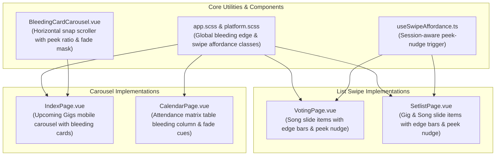

# Implementation Plan: Visual Layout Cues & Bleeding Edges for Swipeable UI Elements

> **For agentic workers:** REQUIRED SUB-SKILL: Use superpowers:subagent-driven-development or superpowers:executing-plans to implement this plan task-by-task. Steps use checkbox (`- [ ]`) syntax for tracking.

**Goal:** Establish intentional, text-free visual layout cues across all swipeable and horizontally scrollable UI elements in Bandstr. Specifically implement bleeding edges (partial off-screen peeking content) for horizontally scrolling cards/carousels, edge affordance cues and onboarding peek-nudge micro-animations for swipe-to-action list items, and bleeding column indicators for horizontal data matrices.

**Architecture:**
- **Bleeding Edge Carousel Component (`BleedingCardCarousel.vue`):** A responsive, touch-friendly horizontal container with CSS scroll snap (`scroll-snap-type: x mandatory`). On mobile screens, items are sized with intentional bleeding edges (e.g., `84vw` card width, leaving ~16% of the next card peeking onto the screen). Edge fade masks (`mask-image: linear-gradient(...)`) provide a soft visual cue of overflowing content. On desktop, it gracefully adapts to multi-column grid layouts.
- **Swipe-to-Action Affordance Layer (`useSwipeAffordance.ts` & CSS):** For `<q-slide-item>` in Voting and Setlist pages, visual cues are provided through dual techniques:
  1. *Permanent Edge Accent Bleed Bars:* Rounded 3.5px colored edge tabs on the active item borders (green for swipe-right/accept/restore, red for swipe-left/archive) providing continuous visual evidence of underlying actions.
  2. *First-view Peek-a-boo Nudge Animation:* A subtle physical micro-animation on first render that peeks the first item laterally by 28px and snaps back, naturally communicating swipeability to the user's brain without instructions or popups.
- **Horizontal Matrix Bleeding Cues:** Apply partial column sizing and right-edge gradient masks to the Calendar attendance matrix table in `CalendarPage.vue` so columns visibly bleed off-screen on mobile.

**Tech Stack:** Vue 3 Composition API, Quasar v2, TypeScript 5.8, SCSS, Vitest.

**Spec:** User prompt requirements:
- "Indicating that a user interface element is swipeable is a classic mobile UX challenge because gestures lack natural visual affordance. If a user doesn't know they can swipe, your feature is effectively invisible."
- "For all elements that are 'swipe-able', we want to have intentional Visual Layout Cues."
- "The cleanest design patterns require no text or explanation because the interface layout itself strongly implies the gesture."
- "Bleeding Edges (Partial Off-Screen Content): For carousels or horizontally scrolling cards, intentionally cut off the next item so it peek-aboos or 'bleeds' onto the side of the screen. Seeing a fraction of a card instantly informs the brain that there is more content to look at if they pull it over."

---

## Global Constraints

- **Strict zero-text affordance:** Visual cues must rely on geometry, partial visibility ("bleeding edges"), accent tabs, and micro-motion — no instructional banners, tooltips, or tutorial overlays.
- **Mobile-first, desktop-safe:** Bleeding edges must activate on mobile viewports (`$q.screen.lt.md` / `<= 768px`) and transition cleanly to standard responsive grids or desktop scroll controls on larger screens.
- **Preserve existing gesture logic:** Existing drag-and-drop reordering, swipe thresholds, and undo toast workflows on Voting and Setlist items must remain 100% functional.
- **Dark & Light mode fidelity:** All edge accents, masks, and card borders must respect CSS variables (`--surface`, `--surface-raised`, `--border`, `--brand`).
- **Strict TypeScript & Unit Tests:** All Vue components must typecheck cleanly with zero lint errors and 100% test pass rate in Vitest.

---

## Review Focus

1. **Card Bleed Proportion on Mobile Viewports:** On small (360px Galaxy S23) and standard (390px iPhone 14) screens, the peeking card must have exactly enough visible bleed (14%–18% of screen width) to be unmistakable as a card edge without crowding the primary card.
2. **Swipe-Item Drag & Drop Coexistence:** In `VotingPage.vue` and `SetlistPage.vue`, adding edge accent bars and peek animations must not interfere with HTML5 drag-and-drop or touch drag handles on songs.
3. **Scroll Snap Precision:** The bleeding carousel must snap cleanly to card boundaries (`scroll-snap-align: start` or `center`) without awkward half-state stops when flicked by the user.
4. **Conditional Edge Bleeds based on Item State:** Archived songs on Voting and Setlist only support swipe-right (reactivate) and cannot be swiped left (archived again). The right-side red edge bar must not appear on items where the action is disabled.
5. **Session-bounded Peek Animation:** The peek-nudge micro-animation on list items must run only once per session (persisted in `sessionStorage`) so returning users are not annoyed by repeated animations.

---

## Proposed Changes



---

### Component 1: Bleeding Edge Carousel & Layout System

#### [NEW] `packages/web/src/components/BleedingCardCarousel.vue`
A reusable component for horizontally scrolling cards featuring:
- Prop `peekPercent` (default `16`% — card width `calc(84vw - 20px)` on mobile).
- CSS Scroll Snap (`scroll-snap-type: x mandatory`).
- Bleeding edge geometry with right padding and offset so the subsequent card is cut off and clearly peeks onto the screen.
- Edge fade mask (`mask-image: linear-gradient(...)`) on the scrolling container to give a soft gradient cutoff at the viewport boundary.
- Responsive switch: On desktop (`>= 768px`), smoothly arranges cards in a responsive multi-column grid or standard wrap without horizontal overflow unless configured.
- Optional swipe indicator dots that update passively based on scroll position (`IntersectionObserver` or scroll listener).

#### [MODIFY] `packages/web/src/css/app.scss` & `packages/web/src/css/platform.scss`
Add global utility classes:
- `.bleeding-edge-container`: Flex container with touch scrolling, hidden scrollbars, and scroll-snap.
- `.bleeding-edge-item`: Items sized to bleed off-screen on mobile (`max-width: 84vw; flex: 0 0 84vw; scroll-snap-align: start`).
- `.edge-fade-mask`: CSS mask for gradient fading at right edge (`mask-image: linear-gradient(to right, black calc(100% - 32px), transparent 100%)`).
- `.swipe-affordance-card`: Subtle card styling for `<q-slide-item>` with rounded corners, inset margins, and visible edge gutters.
- `.swipe-affordance-left`: Green accent pill/strip on the left edge.
- `.swipe-affordance-right`: Red accent pill/strip on the right edge.

---

### Component 2: Swipe-to-Action Visual Affordance Layer

#### [NEW] `packages/web/src/composables/useSwipeAffordance.ts`
Composable managing text-free affordance cues for `<q-slide-item>`:
- `shouldTriggerNudge(featureKey: string): boolean`: Checks `sessionStorage` to ensure the peek-nudge only fires once per session per screen.
- `markNudgeTriggered(featureKey: string): void`: Records that the hint was shown.
- `triggerPeekAnimation(elementRef: HTMLElement | null)`: Performs a smooth physical micro-peek:
  1. Translates 24px left (revealing red archive color strip) over 220ms.
  2. Translates 24px right (revealing green accept color strip) over 280ms.
  3. Returns to 0px with subtle elastic spring over 200ms.
  4. Runs only if `prefers-reduced-motion` is false.

#### [MODIFY] `packages/web/src/pages/VotingPage.vue`
- Enhance `.voting-slide-item`:
  - Add permanent left/right visual edge indicators:
    - Left edge: 3.5px positive green pill (`var(--q-positive)` / `#2e7d32`) on the left border of `.q-slide-item__content` signaling swipe-right to accept/move to setlist (or restore if in archive).
    - Right edge: 3.5px negative red pill (`var(--q-negative)` / `#c62828`) on the right border signaling swipe-left to archive (hidden if song is already archived).
  - Connect `useSwipeAffordance`: On page load, the topmost song card smoothly executes the peek-nudge animation once per session, visually showing the user that the item slides laterally.
  - Inset list styling: Apply subtle card margins (`margin: 4px 8px; border-radius: 10px`) so slide items look like distinct swipeable physical surfaces rather than a flat static table.

#### [MODIFY] `packages/web/src/pages/SetlistPage.vue`
- Enhance `.setlist-slide-item` (Repertoire and Gig song lists):
  - Add permanent visual edge indicator bars:
    - Left edge: positive accent strip (thumb up / move to voting / restore).
    - Right edge: negative accent strip (archive) for active songs.
    - Omit right accent on archived songs and divider rows.
  - In Gigs list (`activeTab === 'gig' && !selectedGigId`):
    - Add left/right edge indicator strips on gig rows so users know gigs can be swiped to archive/restore.
  - Connect `useSwipeAffordance` to peek the first gig / song item on initial visit.

---

### Component 3: Horizontally Scrolling Cards & Table Bleed

#### [MODIFY] `packages/web/src/pages/IndexPage.vue`
- Replace static vertical upcoming gigs list on mobile viewports with `<BleedingCardCarousel>`:
  - On mobile (`$q.screen.lt.md`): Each gig is displayed in a dedicated card (`GigCard`) inside the bleeding carousel.
  - Card width is sized so the next upcoming gig peeks into the viewport by ~16%, immediately demonstrating horizontal swipeability.
  - Date block, gig title, location, description markdown snippet, and "Open Setlist" button are formatted ergonomically.
  - On desktop (`gt-sm`): Automatically switches to the spacious vertical list / multi-column layout.

#### [MODIFY] `packages/web/src/pages/CalendarPage.vue`
- Update Rehearsal Overview attendance matrix modal (`showOverviewModal`):
  - Add `.bleeding-edge-container` and `.edge-fade-mask` to the matrix wrapper.
  - Ensure member columns have defined minimum widths (`min-width: 64px`) so the last column bleeds off-screen on mobile devices, visually implying that more columns are available to pan horizontally.

#### [MODIFY] `packages/web/test/issue-19-enhancements.test.ts`
- Update regex in `issue-19-enhancements.test.ts` to accommodate dynamic `:icon="pIcon('print')"` so all existing tests pass.

---

## Task Decomposition

### Task 1: Global SCSS Affordance Utilities & `useSwipeAffordance` Composable
**Files:**
- Create: `packages/web/src/composables/useSwipeAffordance.ts`
- Create: `packages/web/test/swipe-affordance.test.ts`
- Modify: `packages/web/src/css/app.scss`
- Modify: `packages/web/src/css/platform.scss`

- [ ] **Step 1: Write unit tests for `useSwipeAffordance`**
  - Verify session storage tracking (only triggers once per session).
  - Verify respect for reduced-motion media query.
- [ ] **Step 2: Run test to verify failure**
  Run: `pnpm --filter @bandstr/web test test/swipe-affordance.test.ts`
- [ ] **Step 3: Implement `useSwipeAffordance.ts`**
  - Implement `shouldTriggerNudge`, `markNudgeTriggered`, `triggerPeekAnimation`.
- [ ] **Step 4: Implement SCSS affordance rules in `app.scss` and `platform.scss`**
  - Edge accent bars (`.swipe-edge-indicator--left`, `.swipe-edge-indicator--right`).
  - Inset card styling for slide items with subtle shadow and border radius.
  - Bleeding container snap utilities and gradient mask (`.edge-fade-mask`).
- [ ] **Step 5: Run tests and verify pass**
  Run: `pnpm --filter @bandstr/web test test/swipe-affordance.test.ts`
- [ ] **Step 6: Commit**
  `feat(ui): add visual swipe affordance composable and bleeding edge styling utilities`

---

### Task 2: Reusable `BleedingCardCarousel.vue` Component
**Files:**
- Create: `packages/web/src/components/BleedingCardCarousel.vue`
- Create: `packages/web/test/bleeding-card-carousel.test.ts`

- [ ] **Step 1: Write component tests for `BleedingCardCarousel.vue`**
  - Verify slots rendering, scroll snap classes, and peek width styles.
- [ ] **Step 2: Run test to verify failure**
  Run: `pnpm --filter @bandstr/web test test/bleeding-card-carousel.test.ts`
- [ ] **Step 3: Implement `BleedingCardCarousel.vue`**
  - Prop `peekPercent` (default 16).
  - Scroll snap flex track with passive dot indicators.
  - Edge fade mask for partial off-screen content indication.
- [ ] **Step 4: Run tests and verify pass**
  Run: `pnpm --filter @bandstr/web test test/bleeding-card-carousel.test.ts`
- [ ] **Step 5: Commit**
  `feat(ui): implement BleedingCardCarousel component with scroll snap and peek geometry`

---

### Task 3: Visual Layout Cues on Swipeable List Items (`VotingPage.vue` & `SetlistPage.vue`)
**Files:**
- Modify: `packages/web/src/pages/VotingPage.vue`
- Modify: `packages/web/src/pages/SetlistPage.vue`
- Create: `packages/web/test/swipe-layout-cues.test.ts`

- [ ] **Step 1: Write tests verifying visual edge cues in VotingPage and SetlistPage**
  - Check that song items and gig items include directional edge indicator classes.
  - Verify that archived items suppress redundant archive indicators.
- [ ] **Step 2: Run tests to verify failure**
  Run: `pnpm --filter @bandstr/web test test/swipe-layout-cues.test.ts`
- [ ] **Step 3: Update `VotingPage.vue`**
  - Add edge indicator accent bars to `.voting-slide-item`.
  - Wire `useSwipeAffordance` on the list container to run a one-time peek-nudge on the first item.
  - Style items with inset card aesthetics (`border-radius: 10px; margin: 4px 8px`).
- [ ] **Step 4: Update `SetlistPage.vue`**
  - Add edge indicator accent bars to `.setlist-slide-item` (songs) and gig items in Gig list.
  - Wire `useSwipeAffordance` on first gig/song item.
- [ ] **Step 5: Fix regex in `packages/web/test/issue-19-enhancements.test.ts`**
  - Update `issue-19-enhancements.test.ts` to support `:icon="pIcon('print')"` so all tests pass.
- [ ] **Step 6: Run tests and verify pass**
  Run: `pnpm --filter @bandstr/web test`
- [ ] **Step 7: Commit**
  `feat(ux): add visual edge cues and peek-nudge affordances to voting and setlist slide items`

---

### Task 4: Bleeding Cards in Home Page & Calendar Matrix
**Files:**
- Modify: `packages/web/src/pages/IndexPage.vue`
- Modify: `packages/web/src/pages/CalendarPage.vue`

- [ ] **Step 1: Integrate `BleedingCardCarousel` in `IndexPage.vue` for Upcoming Gigs**
  - On mobile (`$q.screen.lt.md`), wrap upcoming gigs in `<BleedingCardCarousel>`.
  - Format each gig as a standalone card where the next gig peeks onto the right edge by 16%.
  - Maintain desktop layout on larger screens.
- [ ] **Step 2: Enhance Rehearsal Matrix Table in `CalendarPage.vue`**
  - Apply `.edge-fade-mask` and column min-width sizing so the last column bleeds off-screen on mobile.
- [ ] **Step 3: Run full web test suite and typecheck**
  Run: `pnpm --filter @bandstr/web typecheck`
  Run: `pnpm --filter @bandstr/web test`
- [ ] **Step 4: Commit**
  `feat(home,calendar): integrate bleeding edge card carousel for upcoming gigs and table bleed cues`

---

## Verification Plan

### Automated Tests
1. **Unit & Component Tests:**
   ```bash
   pnpm --filter @bandstr/web test
   ```
   *Expected outcome:* All 27 test files pass with 100% green tests.

2. **TypeScript Strict Typecheck:**
   ```bash
   pnpm --filter @bandstr/web typecheck
   ```
   *Expected outcome:* Zero TypeScript errors.

3. **ESLint Verification:**
   ```bash
   pnpm --filter @bandstr/web lint
   ```
   *Expected outcome:* Zero ESLint errors or warnings.

### Manual Verification
1. **Bleeding Edges on Home Page (Mobile Simulation):**
   - Open browser DevTools in responsive mode (390px width - iPhone 14).
   - Navigate to Home (`/`).
   - If 2+ upcoming gigs exist, observe that the first card occupies ~84% width and the second card clearly bleeds into the right edge (~16% visible).
   - Swipe horizontally: Cards snap cleanly to the start edge. The right-edge gradient fade indicates more content until reaching the final card.
2. **Visual Layout Cues in Song Voting (`/voting`):**
   - Navigate to Voting.
   - Observe the left positive edge bar (green) and right negative edge bar (red) on active songs.
   - Observe the initial 600ms micro-nudge animation on the first song card upon page load, physically demonstrating the lateral swipe affordance.
   - Switch to the "Archived" tab: Observe that only the left green (restore) edge indicator is present, accurately signaling available actions.
   - Perform swipe: Swiping right accepts/restores; swiping left archives. Undo toast behaves as expected.
3. **Visual Layout Cues in Setlist (`/setlist`):**
   - Navigate to Setlist -> Gigs tab: Observe edge indicator tabs on gig items showing swipe-to-archive.
   - Open a setlist: Observe edge indicator tabs on songs. Verify drag handle (`drag_handle`) reordering works alongside swipe.
4. **Calendar Attendance Matrix (`/calendar`):**
   - Open Rehearsal Overview on a 390px mobile viewport.
   - Observe the attendance table with bleeding columns and soft right fade mask inviting horizontal panning.
5. **Desktop Layout Integrity:**
   - Resize window to desktop (>1024px).
   - Verify all pages maintain standard desktop layouts without forced card clipping or awkward horizontal overflows.
